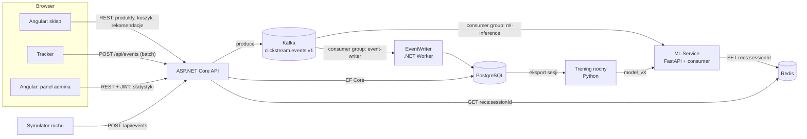

# Architektura

## Komponenty

## Przepływ: kliknięcie → nowa rekomendacja

1. Tracker zbiera eventy, buforuje je i wysyła paczką `POST /api/events` (ADR-0006).
2. API waliduje paczkę, dokleja `serverTs` i wariant eksperymentu, rozbija paczkę na pojedyncze
   eventy i publikuje je do `clickstream.events.v1` z kluczem `sessionId` (ADR-0003).
3. Dwie niezależne grupy konsumentów czytają ten sam topic:
   - `event-writer` zapisuje event do tabeli `events` (ADR-0004),
   - `ml-inference` aktualizuje stan sesji w Redisie, liczy rekomendacje i zapisuje `recs:{sessionId}` (ADR-0005, ADR-0008).
4. Przy kolejnym renderze sklep wywołuje `GET /api/recommendations?sessionId=...`. API czyta Redis.
   Gdy klucza nie ma (cold start, opóźnienie), zwraca fallback popularności kontekstowej (ADR-0009).
5. Sklep wyświetla rekomendacje. Tracker loguje `rec_impression`, a po kliknięciu `rec_click` (ADR-0011).

Spójność jest **ostateczna** (eventual consistency): rekomendacja może nie uwzględniać jeszcze
ostatniego kliknięcia. To świadoma decyzja, która trzyma API szybkie i niezależne od ML.

## Przepływ: trening nocny

1. Skrypt treningowy pobiera sesje z PostgreSQL (albo publiczny dataset w etapie bootstrapu, ADR-0010).
2. Trenuje model, liczy metryki offline na podziale czasowym i zapisuje wyniki do tabeli `model_runs`.
3. Zapisuje artefakt `ml/models/<model>_<data>.pkl|pt` i aktualizuje wskaźnik `current`.
4. ML Service przeładowuje model bez restartu (`POST /admin/reload` albo cykliczne sprawdzanie wskaźnika).

## Granice odpowiedzialności

| Serwis | Robi | Nie robi |
|---|---|---|
| API (C#) | walidacja, katalog, koszyk, ingest, odczyt rekomendacji, auth, statystyki dla dashboardu | żadnej matematyki ML, nie pisze eventów bezpośrednio do bazy |
| EventWriter (C#) | trwały zapis eventów, idempotencja po `eventId` | logiki biznesowej |
| ML Service (Python) | stan sesji, inferencja, zapis do Redisa | nie wystawia danych sklepowi bezpośrednio (tylko health i reload) |
| Trening (Python) | trening, ewaluacja offline, wersjonowanie modeli | nie działa w ścieżce zapytania |
| Angular | UI, tracker, dashboard | nie liczy agregatów analitycznych |

## Powiązane ADR-y

Pełna lista w [adr/README.md](adr/README.md).
